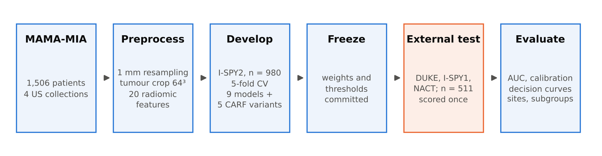
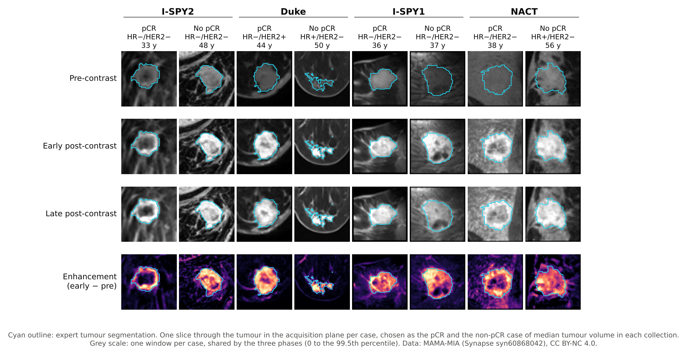
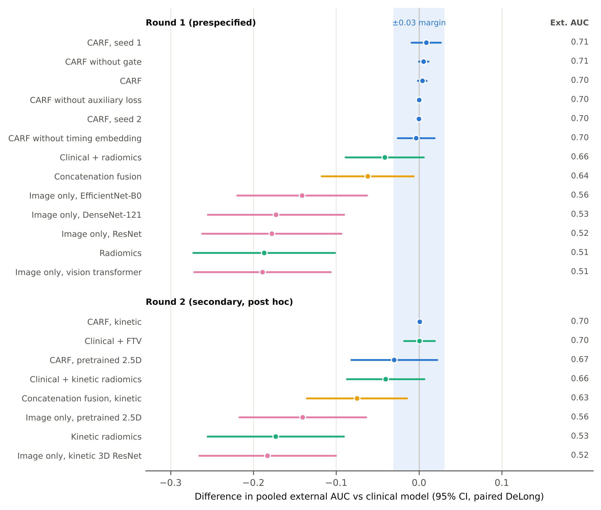
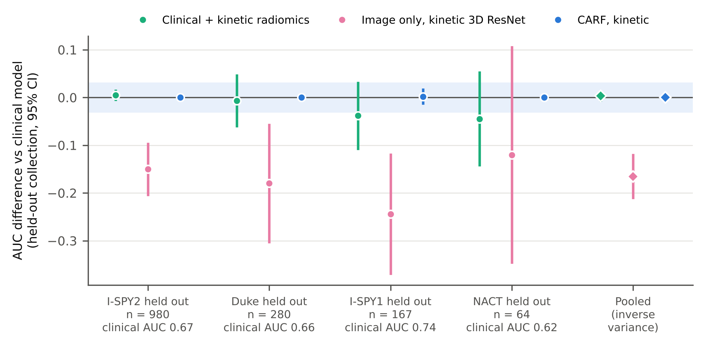
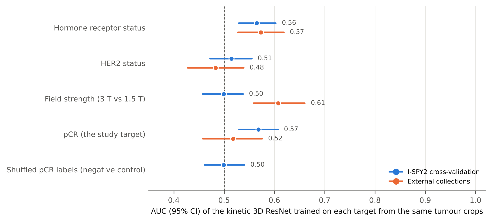

# Does Pretreatment Breast DCE MRI Add to Receptor Status for Predicting Pathologic Complete Response? Multi-institutional External Validation of 16 Imaging-based Models

**Running title:** DCE MRI beyond receptor status for pCR

**Article type:** Original Research

**Authors:** Behnam Kiani Kalejahi (1, 2) and Mohammad Javad Rajabi (2)

1. Department of Computer Science, School of Engineering, Central Asian University, Tashkent, Uzbekistan
2. Faculty of Data Science and Information Technology, INTI International University, Negeri Sembilan, Malaysia

**Corresponding author:** Behnam Kiani Kalejahi, Department of Computer Science, School of Engineering, Central Asian University, Tashkent, Uzbekistan. [[Email and ORCID]]

**Funding:** The authors received no funding for this work.

**Summary statement:** In 1,491 patients from four collections, 16 pretreatment DCE MRI models did not improve external prediction of pathologic complete response beyond age, hormone receptor and HER2 status.

**Key Points**
1. In 511 patients from three held-out collections, a model of age, hormone receptor and HER2 status had an AUC of 0.70; fusing DCE MRI with it changed the AUC by 0.004 (95% CI: −0.002, 0.009), inside a prespecified ±0.03 equivalence margin.
2. None of 16 imaging-based models exceeded the clinical model. Image-only networks, including a pretrained 2.5D network and three-phase kinetic inputs, had external AUCs of 0.51–0.56. Functional tumor volume added 0.000 (95% CI: −0.018, 0.019).
3. Radiomics and naive fusion gained AUC in internal cross-validation (up to 0.065) but lost it externally. On the same tumor crops, the networks predicted hormone receptor status with an AUC of only 0.57.

**Abbreviations:**
- AUC = area under the receiver operating characteristic curve
- CARF = clinically anchored residual fusion
- DCE = dynamic contrast-enhanced
- FTV = functional tumor volume
- HER2 = human epidermal growth factor receptor 2
- HR = hormone receptor
- LOCO = leave-one-collection-out
- pCR = pathologic complete response

**Keywords:** Breast, MRI, Neoadjuvant Therapy, Deep Learning, Prognosis

## Abstract

**Purpose:** To determine whether pretreatment dynamic contrast-enhanced (DCE) MRI improves prediction of pathologic complete response (pCR) to neoadjuvant chemotherapy beyond age, hormone receptor (HR) and HER2 status at external institutions.

**Materials and Methods:** This retrospective study used the public MAMA-MIA dataset: 1,491 women (mean age, 48.5 years ± 10.4) imaged from 1995 to 2016. Models were developed on I-SPY2 (980 patients, 22 sites) and scored once on Duke, I-SPY1 and NACT (511 patients). Sixteen imaging-based models were compared with a clinical model by paired DeLong tests. They comprised 3D and pretrained 2.5D networks, radiomics including functional tumor volume (FTV), and two fusion designs. The prespecified primary end point was the external AUC difference between clinically anchored residual fusion (CARF) and the clinical model, with a ±0.03 equivalence margin. Secondary analyses comprised leave-one-collection-out validation and control tasks.

**Results:** The clinical model had an external AUC of 0.70 (95% CI: 0.65, 0.75). CARF differed by 0.004 (95% CI: −0.002, 0.009), within the margin. No imaging-based model exceeded the clinical model, and image-only networks reached 0.51–0.56. Clinical plus kinetic radiomics had an AUC of 0.72 internally but 0.66 externally. Adding FTV changed the AUC by 0.000 (95% CI: −0.018, 0.019). Across leave-one-collection-out splits, clinical plus kinetic radiomics gained 0.003 (95% CI: −0.006, 0.012). The same networks predicted HR status with an AUC of 0.57.

**Conclusion:** Pretreatment DCE MRI models added no clinically meaningful discrimination to receptor status in external cohorts.

## Introduction

Pathologic complete response (pCR) after neoadjuvant chemotherapy predicts longer event-free and overall survival in breast cancer, especially in triple-negative and HER2-positive disease (1,2). A reliable pretreatment estimate of pCR could support escalation or de-escalation before the first cycle. Dynamic contrast-enhanced (DCE) MRI is acquired routinely for staging, so many groups have tried to predict pCR from it.

Published results are hard to reconcile. A 2025 review of 51 deep learning studies reported a median AUC of 0.88, but most studies were single-center and few were validated externally (3). The MAMA-MIA benchmark harmonized 1,506 patients from four U.S. collections (4). In its 2025 challenge, 26 teams predicted pCR from pretreatment DCE MRI in an external European cohort. The best balanced accuracy was 0.558, and only one submission beat a random classifier (5). Clinical variables were withheld at test time. The challenge therefore could not show whether imaging adds to receptor status, which strongly determines pCR. In an I-SPY2 to I-SPY1 validation, a clinical model matched an attention-based multimodal model (external AUC 0.71 for both) (6).

We asked one prespecified question: does pretreatment DCE MRI improve pCR prediction beyond age and receptor status when models are developed in one trial and tested at other institutions? To our knowledge, no previous study has combined the four features of our design:
- external testing on three collections, with an equivalence margin set in advance;
- 16 imaging-based models, from radiomics to pretrained networks and two fusion designs;
- multi-source leave-one-collection-out validation;
- control tasks that measure what the networks can learn from the same images.

We also tested clinically anchored residual fusion (CARF), in which imaging can only adjust a calibrated clinical prediction through a bounded gate.

## Materials and Methods

### Study Design
This retrospective study developed and externally validated prediction models on public, de-identified data and is reported according to TRIPOD+AI (7) and CLAIM (8). The analysis plan and code were committed to a public repository before external data were scored (round 1). Round-2 analyses were planned after round-1 results were known, and that plan was committed before any round-2 model was trained. Round 2 is secondary. [[Ethics statement]]

### Patients and Data
We used MAMA-MIA (4), distributed through Synapse (syn60868042). It harmonizes pretreatment T1-weighted DCE MRI, expert tumor segmentations and clinical data from four collections of The Cancer Imaging Archive (9):
- I-SPY2;
- I-SPY1 (10);
- Duke (11);
- NACT (12).

We used a Kaggle mirror whose case and pCR counts matched the publication. Images were acquired from 1995 to 2016. Fifteen patients without pCR status were excluded, leaving 1,491 women (Fig 1).

The development cohort was I-SPY2: 980 patients, 316 with pCR, from 22 sites. The external cohort comprised 511 patients with 124 pCR events:
- Duke, 280 patients (64 with pCR);
- I-SPY1, 167 (49);
- NACT, 64 (11).

The outcome was pCR as recorded in each collection. Clinical predictors were age, HR status and HER2 status. Menopausal status and multifocality were dropped before modeling because whole collections lacked them.

### Image Preprocessing
Volumes and masks were resampled to 1-mm isotropic spacing and cropped to a tumor-centered cube. Round 1 used the pre-contrast and first post-contrast phases and their subtraction, resized to 64³ voxels. Round 2 added the last post-contrast phase, washout and the tumor mask (six channels). It also extracted 12 slices of 112 × 112 pixels through the tumor in three planes, for 2.5D models. Signal was scaled to the mean pre-contrast signal of the crop.

### Models
All models were trained on I-SPY2 only and compared with the clinical model (L2 logistic regression).

**Round 1 (prespecified):**
- radiomics, alone and with clinical variables: 20 first-order, shape and rim-to-core features with L1 logistic regression;
- four image-only 3D networks: a residual network, and DenseNet-121, EfficientNet-B0 and a vision transformer from MONAI (13);
- concatenation fusion;
- CARF.

**Round 2 (secondary):**
- 22 kinetic features, including FTV (volume with early enhancement ≥ 70%) and signal enhancement ratio, alone and with clinical variables;
- clinical model plus FTV;
- a kinetic 3D network, with concatenation and CARF fusion;
- an ImageNet-pretrained 2.5D ResNet-18 with attention pooling, alone and with CARF.

In CARF, the frozen clinical logit *z* receives a gated imaging residual:

```latex
\mathrm{logit}(\hat p_i) = z_i + g_i\,\delta_i, \qquad 0 \le g_i \le 1
```

The residual δ comes from tabular tokens attending over image tokens. The gate *g* depends on a distribution-shift score, so unfamiliar images are meant to be down-weighted. Without an image, CARF returns the clinical prediction exactly. Architecture, algorithms, hyperparameters and computing resources are in Appendix S1.

Networks were trained with AdamW for up to 60 epochs on NVIDIA T4 graphics processing units, with fivefold cross-validation and an inner 15% early-stopping split. External predictions averaged the five fold models.

### Statistical Analysis
AUC 95% CIs came from 2,000 stratified bootstrap resamples. Thresholds were set by Youden index on I-SPY2 and applied unchanged externally. Calibration and decision curves (14) were assessed.

The primary analysis was the paired DeLong difference (15) in pooled external AUC between CARF and the clinical model. A 95% CI within ±0.03 was prespecified to indicate no clinically meaningful added value. Other models were compared by DeLong tests with Holm correction within each round.

Secondary analyses:
- **Leave-one-collection-out (LOCO) validation:** train on three collections, test on the fourth, with inverse-variance pooling of differences.
- **Control tasks:** the kinetic 3D network was trained on HR status, HER2 status, field strength and shuffled pCR labels.
- **Added-value tests:** likelihood-ratio tests of each image score added to the clinical logit, overall and within receptor subtypes, and cross-validated stacking within external data as an optimistic bound.
- **Other analyses:** site-level random-effects pooling (16), recalibration and explainability (17,18).

## Results

### Patients
Of the 1,491 women (mean age, 48.5 years ± 10.4), 440 (29.5%) had pCR (Table 1). External collections had lower pCR rates than I-SPY2 (17.2%–29.3% vs 32.2%), different ancestry and, for I-SPY1 and NACT, sagittal 1.5-T acquisition. Figure 2 shows example cases.

### Primary End Point
The clinical model had a pooled external AUC of 0.70 (95% CI: 0.65, 0.75), and CARF had 0.70 (95% CI: 0.65, 0.76). The difference was 0.004 (95% CI: −0.002, 0.009; P = .15), entirely within the margin. CARF matched the clinical model in each collection:

| Collection | CARF AUC | Clinical AUC |
| --- | --- | --- |
| Duke | 0.66 | 0.66 |
| I-SPY1 | 0.78 | 0.77 |
| NACT | 0.62 | 0.62 |

### All Models
No imaging-based model exceeded the clinical model externally (Table 2, Fig 3). Six image-only networks reached 0.51–0.56, including the pretrained 2.5D network and the three-phase kinetic network. Radiomics alone reached 0.51–0.53.

Four models gained AUC internally but lost it externally:
- clinical plus kinetic radiomics: internal gain 0.065 (95% CI: 0.036, 0.094); external difference −0.040 (95% CI: −0.087, 0.007);
- clinical plus round-1 radiomics;
- concatenation fusion;
- kinetic concatenation fusion: external difference −0.075 (95% CI: −0.136, −0.014).

FTV, the I-SPY imaging biomarker, added 0.000 (95% CI: −0.018, 0.019) to the clinical model. The smallest difference detectable with 80% power was 0.027.

CARF with the 3D networks stayed within the margin in all three seeds, three ablations and the kinetic variant. With the pretrained 2.5D encoder, the gate opened (mean 0.71 vs 0.17 with the 3D encoder). Its AUC fell to 0.67, a difference of −0.030 (95% CI: −0.082, 0.022), and its calibration slope fell to 0.60. The shift score did not close the gate on external scans: mean gate values were 0.71–0.73 in all collections.

Calibration of the clinical model and 3D CARF was similar externally (slope, 0.99; Brier score, 0.173). Their decision curves overlapped (Fig 4). An intercept-only update per collection reduced the clinical model's Brier score from 0.175 to 0.166 in Duke and from 0.164 to 0.146 in NACT.

### Multi-source Validation
In LOCO validation, the clinical model's AUC was 0.67 (I-SPY2 held out), 0.66 (Duke), 0.74 (I-SPY1) and 0.62 (NACT) (Fig 5). Pooled differences from the clinical model were:
- clinical plus kinetic radiomics: 0.003 (95% CI: −0.006, 0.012); I² = 0%;
- kinetic CARF: 0.000;
- kinetic 3D network: −0.165 (95% CI: −0.210, −0.120).

Training on more sources therefore did not reveal added value.

### What the Networks Learned
On the same crops, the kinetic 3D network predicted HR status with an AUC of 0.57 (95% CI: 0.53, 0.60) internally and 0.57 externally (Fig 6). Its other control-task AUCs were:

| Target | Internal AUC (95% CI) | External AUC (95% CI) |
| --- | --- | --- |
| HER2 status | 0.51 (0.47, 0.56) | 0.48 (0.43, 0.54) |
| Field strength | 0.50 (0.46, 0.54) | 0.61 (0.56, 0.66) |
| Shuffled pCR labels | 0.50 (0.46, 0.54) | Not tested |

The external field-strength signal reflects differences between collections, because I-SPY1 and NACT were acquired only at 1.5 T.

No image score added information to the clinical logit externally (likelihood-ratio P ≥ .24). The optimistic stacking bound was 0.007 (95% CI: −0.013, 0.026). Within receptor subtypes, discrimination was weak for all models (clinical AUC, 0.55–0.63), and no image score added information (Holm-adjusted P ≥ .44).

Predictions were driven by HR status (mean absolute Shapley value, 0.55) and HER2 status (0.42). CARF's imaging contribution was small (mean absolute logit shift, 0.015–0.038), so Grad-CAM maps were uninformative.

## Discussion

In 511 patients from three held-out collections, 16 pretreatment DCE MRI models did not improve pCR prediction beyond age, HR and HER2 status. The prespecified comparison excluded any gain larger than 0.01. No secondary analysis showed a gain:
- three-phase kinetic inputs;
- an ImageNet-pretrained encoder;
- FTV;
- training on three collections;
- tests within receptor subtypes.

Three findings matter beyond this dataset.

First, internal gains did not transfer. Radiomics and naive fusion improved cross-validated AUC by up to 0.065 and then lost to the clinical model externally. Single-center or random-split studies cannot detect this pattern, and it plausibly explains much of the gap between published AUCs and external results.

Second, the control tasks bound what these networks can learn. Trained on about 1,000 tumor crops, they predicted HR status with an AUC of only 0.57, although HR status is associated with enhancement patterns. A null pCR result therefore reflects how little a network can extract at this data scale, not proof that the images contain no signal. Any future claim should show that its model clears such a control first.

Third, anchoring limits harm but is not a guarantee. CARF with 3D encoders was never worse than the clinical model, because its gate stayed nearly closed. With a stronger pretrained encoder the gate opened, and external discrimination and calibration fell, while the shift score failed to flag the external scans. Anchoring makes the imaging contribution explicit and bounded per patient, but robust shift detection remains unsolved.

**Table 4** compares this study with previous work. Our external AUCs are lower than single-center reports but agree with every cross-institution study on public data (5,6,20). We do not claim higher accuracy. Our contribution is a more reliable estimate of what pretreatment DCE MRI adds where it would be used, and a design that exposes optimistic internal results. Robustness under shift is also the main barrier we have found for imaging models in other settings (22,23).

For practice, receptor status already captures the pretreatment signal these models can extract. Imaging models for pCR should be reported against a receptor-status baseline, with external testing and a control task. More promising directions are early-treatment imaging, which predicted response in I-SPY 1 (10), and larger multi-institution pretraining.

Our study had limitations:
- It was retrospective, all collections were from the United States, and NACT was small (11 events).
- Crops were small (64³ voxels or 112 × 112 slices), and diffusion-weighted imaging was unavailable.
- Round-2 analyses were planned after round-1 results were known, although every round-2 result is reported.
- The radiomics sets were compact and not compliant with the Image Biomarker Standardization Initiative (24).
- pCR definitions varied across trials, and two clinical variables were unusable.

In conclusion, across 16 imaging-based models, external testing on three collections and leave-one-collection-out validation, pretreatment DCE MRI did not add clinically meaningful discrimination to age, HR and HER2 status. Future models should be judged against this baseline.

## Tables

**Table 1: Patient and Acquisition Characteristics**

| Collection | Role | Patients | pCR, n (%) | Age, mean (SD), y | HR+, % | HER2+, % | 3 T, % | Plane | Sites |
| --- | --- | --- | --- | --- | --- | --- | --- | --- | --- |
| I-SPY2 | Development | 980 | 316 (32.2) | 48.8 (10.5) | 54.7 | 24.6 | 27.0 | Axial | 22 |
| Duke | External | 280 | 64 (22.9) | 48.3 (10.9) | 60.7 | 28.2 | 53.9 | Axial | 1 |
| I-SPY1 | External | 167 | 49 (29.3) | 47.6 (9.0) | 55.2 | 32.7 | 0 | Sagittal | 9 |
| NACT | External | 64 | 11 (17.2) | 47.7 (9.6) | 62.0 | 31.9 | 0 | Sagittal | 1 |
| All | — | 1,491 | 440 (29.5) | 48.5 (10.4) | 56.1 | 26.4 | 27.9 | — | 26 |

**Table 2: Internal and External Discrimination of All Models**

| Model | Round | Internal AUC (95% CI) | External AUC (95% CI) | External difference vs clinical (95% CI) | Holm P |
| --- | --- | --- | --- | --- | --- |
| Clinical (age, HR, HER2) | 1 | 0.66 (0.62, 0.69) | 0.70 (0.65, 0.75) | Reference | — |
| CARF, 3D (primary) | 1 | 0.65 (0.62, 0.69) | 0.70 (0.65, 0.76) | 0.004 (−0.002, 0.009) | .77 |
| Clinical + radiomics | 1 | 0.71 (0.68, 0.75) | 0.66 (0.61, 0.71) | −0.042 (−0.089, 0.006) | .51 |
| Concatenation fusion | 1 | 0.69 (0.65, 0.72) | 0.64 (0.58, 0.70) | −0.062 (−0.118, −0.006) | .23 |
| Radiomics | 1 | 0.63 (0.59, 0.66) | 0.51 (0.45, 0.57) | −0.187 (−0.273, −0.101) | < .001 |
| ResNet, image only | 1 | 0.55 (0.51, 0.59) | 0.52 (0.47, 0.58) | −0.178 (−0.262, −0.094) | < .001 |
| DenseNet-121, image only | 1 | 0.55 (0.52, 0.59) | 0.53 (0.47, 0.59) | −0.173 (−0.255, −0.090) | < .001 |
| EfficientNet-B0, image only | 1 | 0.51 (0.47, 0.55) | 0.56 (0.51, 0.62) | −0.141 (−0.220, −0.063) | .004 |
| Vision transformer, image only | 1 | 0.57 (0.53, 0.60) | 0.51 (0.46, 0.57) | −0.189 (−0.272, −0.107) | < .001 |
| Clinical + FTV | 2 | 0.67 (0.63, 0.70) | 0.70 (0.65, 0.75) | 0.000 (−0.018, 0.019) | .96 |
| CARF, kinetic 3D | 2 | 0.65 (0.62, 0.69) | 0.70 (0.65, 0.75) | 0.001 (−0.001, 0.002) | .78 |
| CARF, pretrained 2.5D | 2 | 0.65 (0.61, 0.69) | 0.67 (0.62, 0.72) | −0.030 (−0.082, 0.022) | .78 |
| Clinical + kinetic radiomics | 2 | 0.72 (0.69, 0.75) | 0.66 (0.61, 0.71) | −0.040 (−0.087, 0.007) | .37 |
| Concatenation fusion, kinetic | 2 | 0.69 (0.65, 0.72) | 0.63 (0.57, 0.68) | −0.075 (−0.136, −0.014) | .08 |
| Pretrained 2.5D, image only | 2 | 0.61 (0.57, 0.65) | 0.56 (0.50, 0.62) | −0.140 (−0.217, −0.064) | .002 |
| Kinetic radiomics | 2 | 0.65 (0.61, 0.68) | 0.53 (0.47, 0.59) | −0.173 (−0.255, −0.091) | < .001 |
| Kinetic 3D ResNet, image only | 2 | 0.57 (0.53, 0.61) | 0.52 (0.46, 0.58) | −0.183 (−0.265, −0.100) | < .001 |

Note: Internal = I-SPY2 fivefold cross-validation (n = 980). External = Duke, I-SPY1 and NACT (n = 511; 124 with pCR). Differences are paired DeLong tests. Holm correction was applied within each round; the round-1 family also included the CARF seeds and ablations.

**Table 3: Secondary Analyses**

| Analysis | Comparison | Result (95% CI) |
| --- | --- | --- |
| LOCO, pooled over 4 held-out collections | Clinical + kinetic radiomics vs clinical | 0.003 (−0.006, 0.012) |
| LOCO, pooled | Kinetic CARF vs clinical | 0.000 (−0.000, 0.000) |
| LOCO, pooled | Kinetic 3D ResNet vs clinical | −0.165 (−0.210, −0.120) |
| Stacking within external data (optimistic bound) | Pretrained 2.5D score added to clinical logit | 0.007 (−0.013, 0.026) |
| Control task, external | HR status | AUC 0.57 (0.53, 0.62) |
| Control task, external | HER2 status | AUC 0.48 (0.43, 0.54) |
| Control task, internal | Shuffled pCR labels | AUC 0.50 (0.46, 0.54) |
| Within subtype, external | HR+/HER2− (n = 206; 24 pCR): clinical / kinetic CARF | AUC 0.55 / 0.56 |
| Within subtype, external | HER2+ (n = 147; 56 pCR): clinical / kinetic CARF | AUC 0.63 / 0.63 |
| Within subtype, external | Triple negative (n = 136; 41 pCR): clinical / kinetic CARF | AUC 0.59 / 0.59 |

**Table 4: Comparison with Previous Studies of Pretreatment MRI for pCR Prediction**

| Study | Training data | Inputs | Validation | Result |
| --- | --- | --- | --- | --- |
| Garrucho et al, 2026 (5): MAMA-MIA challenge | MAMA-MIA (1,506) | Pretreatment DCE MRI | External, 3 European centers (516) | Best balanced accuracy 0.558; 1 of 15 better than chance |
| Nishizawa et al, 2025 (6) | I-SPY2 (660) | Pre- and post-treatment MRI + clinical | External, I-SPY1 (114) | Multimodal 0.71; clinical only 0.71; MRI only 0.70 |
| Xu et al, 2025 (19) | MD Anderson triple negative (282) | DCE MRI, DWI, clinical | External, I-SPY2 | Best AUC 0.72 |
| Fridman et al, 2025 (20): BreastDCEDL | I-SPY1, I-SPY2, Duke pooled | Pretreatment DCE MRI | Random split | AUC 0.72; Duke subset 0.54 |
| Braman et al, 2020 (21) | HER2-positive (157) | Pretreatment DCE MRI | External (28 and 29) | AUC 0.85 and 0.77 |
| Krasniqi et al, 2025 (3): review | 51 studies | Multimodal deep learning | Mostly internal | Median AUC 0.88 |
| This study | I-SPY2 (980; 22 sites) | Pretreatment DCE MRI (3 phases) + age, HR, HER2 | External, 3 collections (511), scored once; LOCO; control tasks | Clinical 0.70; best imaging model 0.70; image only 0.51–0.56 |

## Figures



**Figure 1:** Study design and patient flow. Fifteen patients without pCR status were excluded. Models and thresholds were frozen on I-SPY2 (fivefold cross-validation) before the three external collections were scored once.



**Figure 2:** Example cases from MAMA-MIA (Synapse syn60868042; CC BY-NC 4.0). For each collection, the pCR and non-pCR case of median tumor volume: pre-contrast, early and late post-contrast images and early enhancement, with the expert segmentation outlined.



**Figure 3:** Difference in pooled external AUC from the clinical model for every model of both rounds, including CARF seeds and ablations (paired DeLong, 95% CI). The shaded band is the prespecified ±0.03 margin. External AUCs are listed at right.


**Figure 4:** Pooled external receiver operating characteristic curves (a), calibration curves (b) and decision curves (c) for the round-1 models.



**Figure 5:** LOCO validation. Difference in AUC from the clinical model in each held-out collection and pooled by inverse variance.



**Figure 6:** Control tasks. AUC of the kinetic 3D network trained on each target from the same tumor crops, in I-SPY2 cross-validation and in the external collections.

## Appendix S1 (summary)
Architecture diagram (figures/fig_architecture.png), training algorithm, evaluation algorithm, hyperparameters, model sizes and computing resources; the full appendix text is in the Claude Doc version of this manuscript. Subgroup, site-level, calibration and survival tables are in results/final and results/round2 of the repository.

## Data and Code Availability
MAMA-MIA is available from Synapse (syn60868042) under CC BY-NC 4.0. Code, configurations, Kaggle notebooks, per-patient predictions and all result tables are at https://github.com/b-kiani/MAMA-MIA.

## Declarations
**Use of AI tools:** [[Required disclosure. Suggested: "Claude (Anthropic) was used to write analysis code and to draft the manuscript. The authors verified all code, results and text and take full responsibility for the content."]]

**Conflicts of interest:** [[Per author, from the ICMJE form.]]

## References
1. Cortazar P, Zhang L, Untch M, et al. Pathological complete response and long-term clinical benefit in breast cancer: the CTNeoBC pooled analysis. Lancet 2014;384(9938):164–172.
2. I-SPY2 Trial Consortium; Yee D, DeMichele AM, et al. Association of event-free and distant recurrence-free survival with individual-level pathologic complete response in neoadjuvant treatment of stages 2 and 3 breast cancer: three-year follow-up analysis for the I-SPY2 adaptively randomized clinical trial. JAMA Oncol 2020;6(9):1355–1362.
3. Krasniqi E, et al. Multimodal deep learning for predicting neoadjuvant treatment outcomes in breast cancer: a systematic review. Biol Direct 2025. doi:10.1186/s13062-025-00661-8.
4. Garrucho L, Kushibar K, Reidel CA, et al. A large-scale multicenter breast cancer DCE-MRI benchmark dataset with expert segmentations. Sci Data 2025;12(1):453.
5. Garrucho L, Joshi S, et al. The MAMA-MIA Challenge: advancing generalizability and fairness in breast MRI tumor segmentation and treatment response prediction. arXiv 2603.01250 [preprint]. 2026.
6. Nishizawa T, et al. Attention-based multimodal deep learning for interpretable and generalizable prediction of pathological complete response in breast cancer. J Transl Med 2025. doi:10.1186/s12967-025-06617-w.
7. Collins GS, Moons KGM, Dhiman P, et al. TRIPOD+AI statement: updated guidance for reporting clinical prediction models that use regression or machine learning methods. BMJ 2024;385:e078378.
8. Tejani AS, Klontzas ME, Gatti AA, et al. Checklist for Artificial Intelligence in Medical Imaging (CLAIM): 2024 update. Radiol Artif Intell 2024;6(4):e240300.
9. Clark K, Vendt B, Smith K, et al. The Cancer Imaging Archive (TCIA): maintaining and operating a public information repository. J Digit Imaging 2013;26(6):1045–1057.
10. Hylton NM, Blume JD, Bernreuter WK, et al. Locally advanced breast cancer: MR imaging for prediction of response to neoadjuvant chemotherapy—results from ACRIN 6657/I-SPY TRIAL. Radiology 2012;263(3):663–672.
11. Saha A, Harowicz MR, Grimm LJ, et al. A machine learning approach to radiogenomics of breast cancer: a study of 922 subjects and 529 DCE-MRI features. Br J Cancer 2018;119(4):508–516.
12. Newitt D, Hylton N. Single site breast DCE-MRI data and segmentations from patients undergoing neoadjuvant chemotherapy [dataset]. The Cancer Imaging Archive; 2016. [[Confirm DOI on the TCIA collection page.]]
13. Cardoso MJ, Li W, Brown R, et al. MONAI: an open-source framework for deep learning in healthcare. arXiv 2211.02701 [preprint]. 2022.
14. Vickers AJ, Elkin EB. Decision curve analysis: a novel method for evaluating prediction models. Med Decis Making 2006;26(6):565–574.
15. DeLong ER, DeLong DM, Clarke-Pearson DL. Comparing the areas under two or more correlated receiver operating characteristic curves: a nonparametric approach. Biometrics 1988;44(3):837–845.
16. DerSimonian R, Laird N. Meta-analysis in clinical trials. Control Clin Trials 1986;7(3):177–188.
17. Lundberg SM, Lee SI. A unified approach to interpreting model predictions. Adv Neural Inf Process Syst 2017;30:4765–4774.
18. Selvaraju RR, Cogswell M, Das A, et al. Grad-CAM: visual explanations from deep networks via gradient-based localization. Proc IEEE Int Conf Comput Vis 2017:618–626.
19. Xu Z, et al. Deep learning models based on pretreatment MRI and clinicopathological data to predict responses to neoadjuvant systemic therapy in triple-negative breast cancer. Cancers 2025;17(6):966.
20. Fridman N, et al. BreastDCEDL: a comprehensive breast cancer DCE-MRI dataset and transformer implementation for treatment response prediction. arXiv 2506.12190 [preprint]. 2025.
21. Braman N, et al. Deep learning-based prediction of response to HER2-targeted neoadjuvant chemotherapy from pre-treatment dynamic breast MRI: a multi-institutional validation study. arXiv 2001.08570 [preprint]. 2020.
22. Kiani Kalejahi B, Rajabi MJ. Deep learning for brain tumour segmentation on MRI with focus on robustness, uncertainty and clinical translation. Discov Artif Intell 2026;6:1290. doi:10.1007/s44163-026-01713-2.
23. Kiani Kalejahi B, Khan S, Rajabi MJ. GDNet: a robust 2.5D multimodal MRI brain tumor segmentation framework with EMA stabilization and tumor-aware sampling. J Imaging 2026;12(7):288. doi:10.3390/jimaging12070288.
24. Zwanenburg A, Vallières M, Abdalah MA, et al. The Image Biomarker Standardization Initiative: standardized quantitative radiomics for high-throughput image-based phenotyping. Radiology 2020;295(2):328–338.
