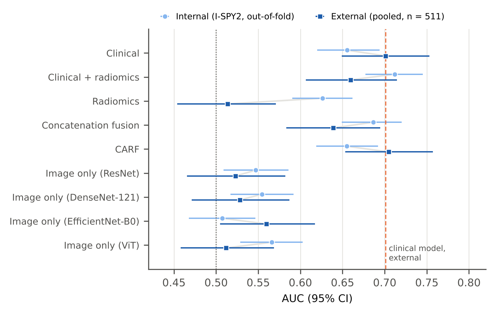
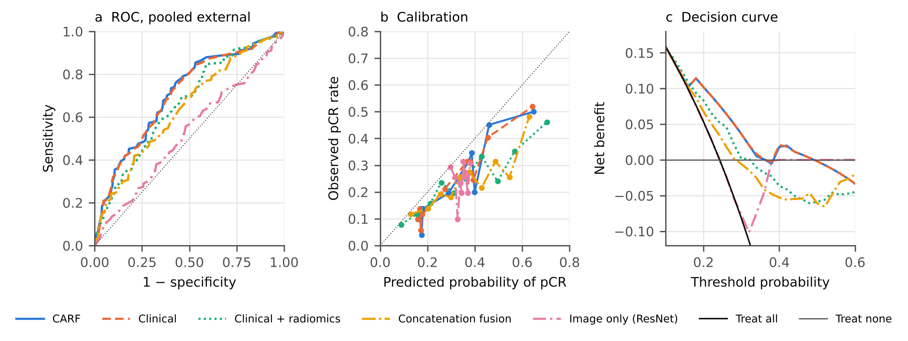
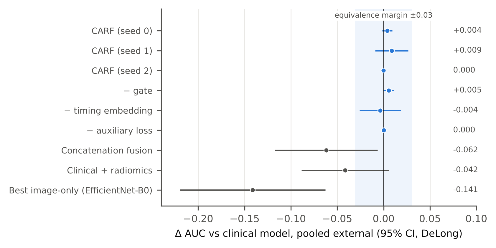
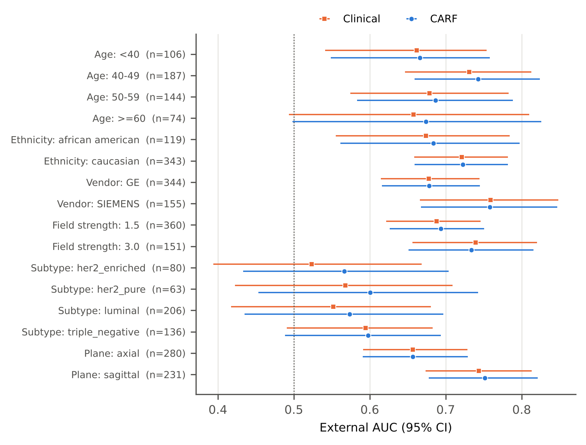

# Pretreatment Breast DCE MRI and Receptor Status for Predicting Pathologic Complete Response: Multi-institutional External Validation of Imaging, Radiomics and Clinically Anchored Fusion Models

Target journal: Radiology: Artificial Intelligence (Original Research). The living, editable version of this manuscript is the Claude Doc. This file is the repository copy as of 15 Nov 2026.

**Authors:** [[names, degrees, affiliations, ORCID; a breast radiologist or oncologist co-author is advised]]

**Summary statement:** In 1,491 patients from four collections, pretreatment DCE MRI deep learning did not improve external prediction of pathologic complete response beyond age, hormone receptor and HER2 status.

**Key Points**
1. A model of age, hormone receptor and HER2 status had an external AUC of 0.70 (95% CI: 0.65, 0.75) in 511 patients from three held-out collections. A clinically anchored fusion with DCE MRI had an AUC of 0.70 (95% CI: 0.65, 0.76). The difference was 0.004 (95% CI: −0.002, 0.009), inside the prespecified ±0.03 equivalence margin.
2. Four image-only 3D networks had external AUCs of 0.51–0.56. Radiomics and concatenation fusion gained AUC internally but lost it externally (0.71 to 0.66, and 0.69 to 0.64).
3. Anchoring imaging as a gated residual on the clinical prediction kept discrimination and calibration at least as good as the clinical model in every collection, seed and ablation.

**Abbreviations:**
- AUC = area under the receiver operating characteristic curve
- CARF = clinically anchored residual fusion
- DCE = dynamic contrast-enhanced
- HER2 = human epidermal growth factor receptor 2
- HR = hormone receptor
- pCR = pathologic complete response

**Keywords:** Breast, MRI, Neoadjuvant Therapy, Deep Learning, Prognosis

## Abstract

**Purpose:** To determine whether pretreatment dynamic contrast-enhanced (DCE) MRI improves prediction of pathologic complete response (pCR) to neoadjuvant chemotherapy for breast cancer beyond age, hormone receptor (HR) and HER2 status when models are tested at external institutions.

**Materials and Methods:** This retrospective study used the public MAMA-MIA dataset: 1,491 women (mean age, 48.5 years ± 10.4) imaged from 1995 to 2016 in four collections. Models were developed on I-SPY2 (980 patients, 22 sites) with fivefold cross-validation. They were tested once, after freezing, on Duke, I-SPY1 and NACT (511 patients). The models compared were a clinical logistic model, radiomics, four three-dimensional image-only networks, concatenation fusion, and clinically anchored residual fusion (CARF). CARF adds a gated imaging correction to the clinical prediction. The prespecified primary end point was the paired difference in pooled external area under the receiver operating characteristic curve (AUC) between CARF and the clinical model, with a ±0.03 equivalence margin.

**Results:** The external pCR rate was 24.3% (124 of 511). The clinical model had an external AUC of 0.70 (95% CI: 0.65, 0.75), and CARF had an AUC of 0.70 (95% CI: 0.65, 0.76). The difference was 0.004 (95% CI: −0.002, 0.009; P = .15), inside the equivalence margin. Image-only networks had AUCs of 0.51–0.56. Radiomics and concatenation fusion had higher internal AUCs than the clinical model (0.71 and 0.69 vs 0.66) but lower external AUCs (0.66 and 0.64). For concatenation fusion, the difference was −0.06 (95% CI: −0.12, −0.01). CARF calibration matched the clinical model (slope, 0.99 vs 0.99; Brier score, 0.17 vs 0.17).

**Conclusion:** In external cohorts, pretreatment DCE MRI models did not improve pCR prediction beyond receptor status by a clinically meaningful amount, and internal gains from imaging did not transfer.

## Introduction

Pathologic complete response (pCR) after neoadjuvant chemotherapy predicts longer event-free and overall survival in breast cancer, especially in triple-negative and HER2-positive disease (1,2). A reliable pretreatment estimate of pCR could support escalation or de-escalation before the first cycle. Dynamic contrast-enhanced (DCE) MRI is acquired routinely for local staging, so many groups have tried to predict pCR from it.

Published results are hard to reconcile. A 2025 systematic review of 51 deep learning studies reported a median AUC of 0.88, but most studies were single-center and few were validated externally (3). MAMA-MIA, a harmonized public benchmark, assembled 1,506 patients from four U.S. collections (4). Its 2025 challenge asked 26 teams to predict pCR from pretreatment DCE MRI in an external European cohort. The best balanced accuracy was 0.558, and only one submission beat a random classifier (5).

That challenge withheld clinical variables at test time. It therefore could not show whether imaging adds to what receptor status already says. This is the clinically relevant question: receptor subtype strongly determines pCR, so an imaging model is useful only if it adds to it. Where this has been examined on public data, the answer has been sobering. In an I-SPY2 to I-SPY1 validation, a clinical model matched an attention-based multimodal model (external AUC 0.71 for both), even though the multimodal model also used post-treatment MRI (6).

We designed this study around one prespecified question. Does pretreatment DCE MRI improve pCR prediction beyond age and receptor status when models are developed in one trial and tested at different institutions, eras and scanners?

To answer it, we compared clinical, radiomics, image-only and fusion models with collection-level external testing. We also tested a fusion design, clinically anchored residual fusion (CARF). In CARF, imaging can only adjust a calibrated clinical prediction through a bounded gate, and the model reduces exactly to the clinical model when imaging is uninformative. This design separates the value of imaging from the harm that naive fusion can do.

## Materials and Methods

### Study Design
This retrospective study developed and externally validated prediction models on public, de-identified data. It is reported according to TRIPOD+AI (7) and CLAIM (8). The analysis plan, model configurations and code were committed to a public repository before external data were scored. [[Ethics statement]]

### Patients and Data
We used MAMA-MIA (4). It harmonizes pretreatment T1-weighted DCE MRI and clinical data from four collections of The Cancer Imaging Archive (9): I-SPY2, I-SPY1 (10), Duke (11) and NACT (12). Each case has an expert segmentation of the primary tumor. Per-collection case and pCR counts matched the dataset publication. Fifteen patients without pCR status were excluded (Duke, 11; I-SPY1, 4), leaving 1,491 women.

- **Development cohort:** I-SPY2, 980 patients (316 with pCR) from 22 sites.
- **External cohort:** Duke (280 patients; 64 with pCR), I-SPY1 (167; 49) and NACT (64; 11), for a total of 511 patients and 124 events. It differs from the development cohort in era, acquisition plane (I-SPY1 and NACT are sagittal) and contrast timing.

### Outcome and Predictors
The outcome was pCR as recorded in each source collection. Clinical predictors were age, HR status and HER2 status. Two variables were dropped before any modeling because whole collections lacked them:
- menopausal status, missing for all of I-SPY1 and NACT;
- multifocality, missing for 94% of I-SPY1.

Treatment arm was not used because it is assigned after imaging.

### Image Preprocessing and Radiomics
Pre-contrast and first post-contrast volumes and the tumor mask were processed in four steps:
1. Resampled to 1-mm isotropic spacing.
2. Z-scored jointly across both phases.
3. Cropped to a tumor-centered cube (side, 1.25 × largest tumor extent; minimum, 32 mm).
4. Resized to 64³ voxels.

The input channels were pre-contrast, post-contrast and their subtraction.

Twenty radiomic features were computed inside the mask:
- first-order statistics of the post-contrast and subtraction images;
- surface-to-volume ratio;
- rim-to-core enhancement ratio;
- log tumor volume;
- largest extent.

### Models
All models were trained on I-SPY2 only.
- **Clinical:** L2-penalized logistic regression.
- **Radiomics, and clinical plus radiomics:** L1-penalized logistic regression.
- **Image only:** four 3D networks with identical inputs and schedules: a residual network (ResNet), and DenseNet-121, EfficientNet-B0 and a vision transformer from MONAI (13).
- **Concatenation fusion:** ResNet features plus tabular features, passed to a multilayer perceptron.
- **CARF:** logit(p̂ᵢ) = zᵢ^clin + gᵢ·δᵢ, with 0 ≤ gᵢ ≤ 1. Here z^clin is the frozen clinical logit, δ is an imaging residual from cross-attention of tabular tokens over ResNet image tokens with a contrast-timing embedding, and g is a gate driven by a Mahalanobis distribution-shift score. With the image absent, CARF returns the clinical prediction exactly.

**Training:**
- AdamW optimizer, up to 60 epochs, mixed precision on one NVIDIA T4 GPU.
- Fivefold stratified cross-validation. Early stopping used an inner 15% split, so out-of-fold predictions were never used for model selection.
- External predictions averaged the five fold models.

**Ablations and seeds:** We trained CARF without the gate, without the timing embedding and without the auxiliary loss, and retrained it with two further seeds. All configurations were fixed before external scoring.

### Statistical Analysis
AUCs had 95% CIs from 2,000 stratified bootstrap resamples. Thresholds were set by Youden index on out-of-fold predictions and applied unchanged to external data. Calibration was assessed by intercept, slope, expected calibration error and Brier score. Clinical utility was assessed by decision curves (14).

The prespecified primary analysis was the paired DeLong difference (15) in pooled external AUC between CARF and the clinical model. It was interpreted as follows:
- lower 95% bound above 0: imaging adds value;
- whole interval within ±0.03: no clinically meaningful added value;
- otherwise: inconclusive.

Other models were compared with the clinical model by Holm-corrected DeLong tests.

Secondary analyses were:
- random-effects meta-analysis across I-SPY2 sites (16);
- subgroup analyses;
- clinical-model variants;
- leave-one-collection-out validation;
- exploratory recurrence-free survival analysis.

### Explainability
Clinical predictions were explained with exact Shapley values (17). For CARF, Grad-CAM (18) was computed on the imaging contribution g·δ and checked with a tumor-mask enrichment test and a deletion test.

## Results

### Patient Characteristics
The study included 1,491 women (mean age, 48.5 years ± 10.4), and 440 (29.5%) had pCR (Table 1, Fig 1). The external cohorts differed from I-SPY2 in three ways:
- **pCR rate:** lower (17.2%–29.3% vs 32.2%).
- **Ancestry:** 30.4% of Duke patients were Black vs 11.8% of I-SPY2 patients.
- **Acquisition:** two collections were sagittal, 1.5-T only. HR or HER2 status was missing for 26.6% of NACT patients.

**Table 1: Patient and Acquisition Characteristics**

| Collection | Role | Patients | pCR, n (%) | Age, mean (SD), y | HR+, % | HER2+, % | 3 T, % | Plane | Sites |
| --- | --- | --- | --- | --- | --- | --- | --- | --- | --- |
| I-SPY2 | Development | 980 | 316 (32.2) | 48.8 (10.5) | 54.7 | 24.6 | 27.0 | Axial | 22 |
| Duke | External | 280 | 64 (22.9) | 48.3 (10.9) | 60.7 | 28.2 | 53.9 | Axial | 1 |
| I-SPY1 | External | 167 | 49 (29.3) | 47.6 (9.0) | 55.2 | 32.7 | 0 | Sagittal | 9 |
| NACT | External | 64 | 11 (17.2) | 47.7 (9.6) | 62.0 | 31.9 | 0 | Sagittal | 1 |
| All | — | 1,491 | 440 (29.5) | 48.5 (10.4) | 56.1 | 26.4 | 27.9 | — | 26 |

### Primary End Point
The pooled external AUC was 0.70 (95% CI: 0.65, 0.75) for the clinical model and 0.70 (95% CI: 0.65, 0.76) for CARF. The paired difference was 0.004 (95% CI: −0.002, 0.009; P = .15). Because the interval lay inside the ±0.03 margin, imaging added no clinically meaningful discrimination. CARF also matched the clinical model within each collection:

| Collection | CARF AUC | Clinical AUC |
| --- | --- | --- |
| Duke | 0.66 | 0.66 |
| I-SPY1 | 0.78 | 0.77 |
| NACT | 0.62 | 0.62 |

### Internal and External Discrimination
Image-only networks were near chance, with external AUCs of 0.51–0.56. CARF exceeded the best of them (EfficientNet-B0) by 0.15 (95% CI: 0.07, 0.22; P < .001).

Adding imaging information without anchoring raised internal AUC but lowered external AUC:

| Model | Internal AUC | External AUC |
| --- | --- | --- |
| Clinical model (reference) | 0.66 | 0.70 |
| Clinical plus radiomics | 0.71 | 0.66 |
| Concatenation fusion | 0.69 | 0.64 |
| Clinical model plus tumor size | 0.71 | 0.67 |

For concatenation fusion, the external difference from the clinical model was −0.06 (95% CI: −0.12, −0.01; Holm-adjusted P = .23).

**Table 2: Internal and External Discrimination**

| Model | I-SPY2 cross-validated AUC (95% CI) | Pooled external AUC (95% CI) | External difference vs clinical (95% CI) | Holm-adjusted P |
| --- | --- | --- | --- | --- |
| Clinical (age, HR, HER2) | 0.66 (0.62, 0.69) | 0.70 (0.65, 0.75) | Reference | — |
| CARF | 0.65 (0.62, 0.69) | 0.70 (0.65, 0.76) | 0.004 (−0.002, 0.009) | .77 |
| Clinical + radiomics | 0.71 (0.68, 0.75) | 0.66 (0.61, 0.71) | −0.04 (−0.09, 0.01) | .51 |
| Concatenation fusion | 0.69 (0.65, 0.72) | 0.64 (0.58, 0.69) | −0.06 (−0.12, −0.01) | .23 |
| Radiomics only | 0.63 (0.59, 0.66) | 0.51 (0.45, 0.57) | −0.19 (−0.27, −0.10) | < .001 |
| ResNet | 0.55 (0.51, 0.59) | 0.52 (0.47, 0.58) | −0.18 (−0.26, −0.09) | < .001 |
| DenseNet-121 | 0.55 (0.52, 0.59) | 0.53 (0.47, 0.59) | −0.17 (−0.26, −0.09) | < .001 |
| EfficientNet-B0 | 0.51 (0.47, 0.55) | 0.56 (0.50, 0.62) | −0.14 (−0.22, −0.06) | .004 |
| Vision transformer | 0.57 (0.53, 0.60) | 0.51 (0.46, 0.57) | −0.19 (−0.27, −0.11) | < .001 |

### Calibration and Clinical Utility
On external data, the clinical model and CARF were calibrated alike (Fig 3). The negative intercepts reflect the lower external prevalence.

| Measure | Clinical model | CARF |
| --- | --- | --- |
| Calibration slope | 0.99 | 0.99 |
| Calibration intercept | −0.44 | −0.46 |
| Brier score | 0.173 | 0.173 |
| Sensitivity at frozen threshold | 0.80 (99/124) | 0.80 (99/124) |
| Specificity at frozen threshold | 0.52 | 0.51 |

Image-only and radiomics models had calibration slopes of 0.03–0.44.

In decision curves, the clinical model and CARF had overlapping net benefit up to a threshold probability of about 0.35. Concatenation fusion and radiomics had lower net benefit.

### Robustness and Heterogeneity
Every CARF variant had an external AUC between 0.697 and 0.710, and every difference from the clinical model lay within the margin (Fig 4). The variants were three seeds and three ablations: without the gate, without the timing embedding and without the auxiliary loss.

Pooled AUCs across 18 I-SPY2 sites were similar:
- clinical model, 0.65 (I² = 6%);
- CARF, 0.66 (I² = 16%).

In leave-one-collection-out validation, the clinical model's AUC ranged from 0.62 to 0.74. It matched or exceeded clinical plus radiomics in every held-out collection.

Subgroup results were consistent (Fig 5). Within receptor subtypes, both models discriminated poorly (AUC, 0.52–0.60).

### Explainability
The imaging contribution to CARF was small:
- **Gate:** the mean gate value was 0.15 in every collection.
- **Imaging logit shift:** the mean absolute shift was 0.015–0.038.
- **Deletion test:** removing the top 25% of attributed voxels changed the logit by 0.0008.

Grad-CAM maps were therefore uninformative.

Predictions were driven by HR status (mean |Shapley value|, 0.55) and HER2 status (0.42). Age contributed little (0.05).

The exploratory recurrence analysis included 501 patients with 107 events. Predicted non-response was inversely related to recurrence (C index, 0.44). This is consistent with HER2-positive and triple-negative disease having both higher pCR and higher recurrence risk.

## Discussion

In 511 patients from three held-out collections, pretreatment DCE MRI did not improve pCR prediction beyond age, HR status and HER2 status by a clinically meaningful amount. The 95% CI of the AUC difference (−0.002 to 0.009) excluded any gain greater than 0.01. This result was prespecified, held in every external collection, and was stable across seeds and ablations.

Two further findings stand out.

First, internal gains from imaging did not transfer. Radiomics and concatenation fusion improved cross-validated AUC by 0.03–0.06 but performed worse than the clinical model externally. This suggests they learned features of the development scans rather than tumor biology.

Second, how imaging is fused determines whether it does harm. CARF was the only fusion model never worse than the clinical model.

**Table 3: Comparison with Previous Studies**

| Study | Training data | Inputs | Validation | Result |
| --- | --- | --- | --- | --- |
| Garrucho et al, 2026 (5) | MAMA-MIA (1,506) | Pretreatment DCE MRI | External, 3 European centers (516) | Best balanced accuracy 0.558 |
| Nishizawa et al, 2025 (6) | I-SPY2 (660) | Pre- and post-treatment MRI + clinical | External, I-SPY1 (114) | Multimodal 0.71; clinical 0.71; MRI 0.70 |
| Xu et al, 2025 (19) | MD Anderson triple-negative (282) | DCE, DWI, clinical | External, I-SPY2 | Best AUC 0.72 |
| Fridman et al, 2025 (20) | I-SPY1, I-SPY2, Duke | Pretreatment DCE MRI | Random split | AUC 0.72; Duke subset 0.54 |
| Braman et al, 2020 (21) | HER2-positive (157) | Pretreatment DCE MRI | External (28 and 29 patients) | AUC 0.85 and 0.77 |
| Krasniqi et al, 2025 (3) | 51 studies | Multimodal deep learning | Mostly internal | Median AUC 0.88 |
| This study | I-SPY2 (980; 22 sites) | DCE MRI + age, HR, HER2 | External, 3 collections (511), single scoring | Clinical 0.70; CARF 0.70; image only 0.51–0.56 |

Our external AUCs are consistent with every cross-institution study on public data (5,6,20). Compared with prior studies, this one combines four features:
- a larger external cohort;
- a prespecified equivalence analysis;
- four backbones and two fusion designs evaluated under one protocol;
- an explanation of why internal gains failed to transfer.

We do not claim higher accuracy. Rather, we give a more reliable estimate of what pretreatment DCE MRI adds when tested where it would be used.

**Implications:**
- **For clinical use:** imaging models for pCR should be reported against a receptor-status baseline and validated externally.
- **For model design:** anchoring imaging as a gated residual is a practical safeguard against harm from fusion.
- **For future research:** within-subtype discrimination was poor. Subtype-specific signals, such as early-treatment change, kinetics and peritumoral features, are where imaging may still add value.

**Limitations:**
- The study was retrospective and used public data from U.S. collections only.
- NACT was small (11 events).
- Only two DCE phases were used, at 64³ resolution.
- The radiomics set was compact and not compliant with the Image Biomarker Standardization Initiative (22).
- Networks were trained from scratch, without foundation-model pretraining.
- Two clinical variables could not be used because whole collections lacked them.
- pCR definitions varied across collections.
- The survival analysis was exploratory.

**Conclusion:** In independent collections, pretreatment DCE MRI deep learning, radiomics and fusion models did not improve pCR prediction beyond age, HR status and HER2 status. Future imaging models should be judged against this baseline. Clinically anchored fusion offers a way to add imaging without losing what the clinical model already provides.

## Data and Code Availability
MAMA-MIA: Synapse syn60868042 (CC BY-NC 4.0). Code, configurations, Kaggle notebooks, frozen predictions and result tables: https://github.com/b-kiani/MAMA-MIA (results/final).

## References
1. Cortazar P, Zhang L, Untch M, et al. Pathological complete response and long-term clinical benefit in breast cancer: the CTNeoBC pooled analysis. Lancet 2014;384(9938):164–172.
2. I-SPY2 Trial Consortium; Yee D, DeMichele AM, et al. Association of event-free and distant recurrence-free survival with individual-level pathologic complete response in neoadjuvant treatment of stages 2 and 3 breast cancer: three-year follow-up analysis for the I-SPY2 adaptively randomized clinical trial. JAMA Oncol 2020;6(9):1355–1362.
3. Krasniqi E, et al. Multimodal deep learning for predicting neoadjuvant treatment outcomes in breast cancer: a systematic review. Biol Direct 2025. doi:10.1186/s13062-025-00661-8.
4. Garrucho L, Kushibar K, Reidel CA, et al. A large-scale multicenter breast cancer DCE-MRI benchmark dataset with expert segmentations. Sci Data 2025;12(1):453.
5. Garrucho L, Joshi S, et al. The MAMA-MIA Challenge: advancing generalizability and fairness in breast MRI tumor segmentation and treatment response prediction. arXiv 2603.01250 [preprint]. 2026.
6. Nishizawa T, et al. Attention-based multimodal deep learning for interpretable and generalizable prediction of pathological complete response in breast cancer. J Transl Med 2025. doi:10.1186/s12967-025-06617-w.
7. Collins GS, Moons KGM, Dhiman P, et al. TRIPOD+AI statement: updated guidance for reporting clinical prediction models that use regression or machine learning methods. BMJ 2024;385:e078378.
8. Tejani AS, Klontzas ME, Gatti AA, et al. Checklist for Artificial Intelligence in Medical Imaging (CLAIM): 2024 update. Radiol Artif Intell 2024;6(4):e240300.
9. Clark K, Vendt B, Smith K, et al. The Cancer Imaging Archive (TCIA): maintaining and operating a public information repository. J Digit Imaging 2013;26(6):1045–1057.
10. Hylton NM, Blume JD, Bernreuter WK, et al. Locally advanced breast cancer: MR imaging for prediction of response to neoadjuvant chemotherapy—results from ACRIN 6657/I-SPY TRIAL. Radiology 2012;263(3):663–672.
11. Saha A, Harowicz MR, Grimm LJ, et al. A machine learning approach to radiogenomics of breast cancer: a study of 922 subjects and 529 DCE-MRI features. Br J Cancer 2018;119(4):508–516.
12. Newitt D, Hylton N. Single site breast DCE-MRI data and segmentations from patients undergoing neoadjuvant chemotherapy [dataset]. The Cancer Imaging Archive; 2016. [[confirm DOI]]
13. Cardoso MJ, Li W, Brown R, et al. MONAI: an open-source framework for deep learning in healthcare. arXiv 2211.02701 [preprint]. 2022.
14. Vickers AJ, Elkin EB. Decision curve analysis: a novel method for evaluating prediction models. Med Decis Making 2006;26(6):565–574.
15. DeLong ER, DeLong DM, Clarke-Pearson DL. Comparing the areas under two or more correlated receiver operating characteristic curves: a nonparametric approach. Biometrics 1988;44(3):837–845.
16. DerSimonian R, Laird N. Meta-analysis in clinical trials. Control Clin Trials 1986;7(3):177–188.
17. Lundberg SM, Lee SI. A unified approach to interpreting model predictions. Adv Neural Inf Process Syst 2017;30:4765–4774.
18. Selvaraju RR, Cogswell M, Das A, et al. Grad-CAM: visual explanations from deep networks via gradient-based localization. Proc IEEE Int Conf Comput Vis 2017:618–626.
19. Xu Z, et al. Deep learning models based on pretreatment MRI and clinicopathological data to predict responses to neoadjuvant systemic therapy in triple-negative breast cancer. Cancers 2025;17(6):966.
20. Fridman N, et al. BreastDCEDL: a comprehensive breast cancer DCE-MRI dataset and transformer implementation for treatment response prediction. arXiv 2506.12190 [preprint]. 2025.
21. Braman N, et al. Deep learning-based prediction of response to HER2-targeted neoadjuvant chemotherapy from pre-treatment dynamic breast MRI: a multi-institutional validation study. arXiv 2001.08570 [preprint]. 2020.
22. Zwanenburg A, Vallières M, Abdalah MA, et al. The Image Biomarker Standardization Initiative: standardized quantitative radiomics for high-throughput image-based phenotyping. Radiology 2020;295(2):328–338.
